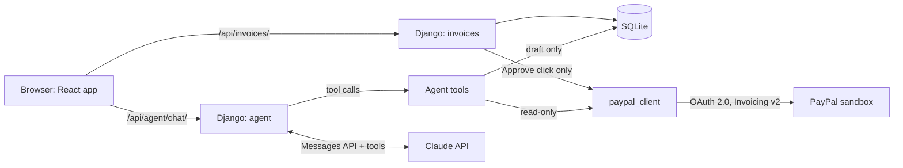

# Receipts.

**You did the work. We keep the receipts.**

Receipts is an AI agent that helps freelancers **keep the money they've earned** by defending PayPal disputes with real evidence. It's built for the [PayPal AI Hackathon](https://paypalaihackathon.devpost.com/) with PayPal's sandbox APIs and Anthropic's Claude.

**Live demo: [receipts-zh30.onrender.com](https://receipts-zh30.onrender.com)** (free hosting: the first load after a quiet spell can take about a minute)

> **Status (25 Oct 2026):** Week 1 complete. Chat-to-invoice with human approval works against the real PayPal sandbox and is deployed on Render. The dispute-defence agent is in progress (Week 2). See [Roadmap](#roadmap).

---

## The problem

Freelancers and small service businesses sell **intangible work**: designs, code, copy, consulting. When a client opens a PayPal dispute saying *"item not received"* or *"not as described"*, there's no tracking number to prove delivery. Many freelancers lose money they earned because they reply late, reply emotionally, or can't pull their evidence together in time.

## The solution

Receipts keeps the paper trail and does the legwork:

```
Invoice sent → client disputes it → AI drafts evidence from real records → you approve → evidence submitted → dispute settled
```

- **The AI drafts, you decide.** Every PayPal write action (sending an invoice, submitting evidence) needs an explicit **Approve** click. The agent has no tool that can send anything or move money, and this is enforced in code, not just in the prompt.
- **Honest by design.** The dispute agent may only cite evidence that exists in your records, and every claim links to its source.
- **Strictly professional where it counts.** The app has a friendly voice, but the text sent to PayPal is factual and formal.

---

## Features

| Feature | Status |
|---|---|
| Chat with the agent to draft an invoice ("Invoice Ahmed £450 for the logo pack") | **Done** |
| Human approval step: Approve & send via PayPal, or Reject | **Done** |
| Create and send invoices through PayPal Invoicing API v2 (sandbox) | **Done** |
| "What the agent did" log under every reply | **Done** |
| Double-click protection (an invoice can never be sent twice) | **Done** |
| Dispute-Defence Agent: fetch dispute → draft sourced evidence → approve → submit → settle | In progress (Week 2) |
| PayPal Transaction Search (via APIMatic's SDK) as payment evidence | In progress (Week 2) |
| `seed_demo` command for a one-step demo reset | In progress (Week 2) |
| AG Grid dashboard: status chips, filters, grouping, pinned totals | Planned (Week 3) |
| pandas insights panel ("£450 at risk across 2 open disputes") | Planned (Week 3) |
| Demo mode banner and Reset demo button on the hosted site | Planned (Week 3) |

---

## Tech stack

| Layer | Technology |
|---|---|
| Backend | Python 3.13, **Django 5.2**, **Django REST Framework** |
| AI | **Anthropic Claude API** with tool calling (`claude-haiku-5-5` in development, `claude-sonnet-5-5` for the demo) |
| Payments | **PayPal REST APIs (sandbox)**: OAuth 2.0, Invoicing v2, Disputes v1 (Week 2), Transaction Search (Week 2) |
| PayPal SDK | **APIMatic-generated PayPal Python SDK** (Transaction Search) |
| Frontend | **React 19** with **Vite**, plain JavaScript |
| Data grid | **AG Grid Community** (Week 3) |
| Database | SQLite |
| Hosting | **Render** (one web service: Django serves the built React app via WhiteNoise, run by gunicorn) |
| Tests | Django test runner, with PayPal mocked so tests never touch the network |

---

## Architecture



**How a request flows:** one server and one URL. Django answers `/api/...` with JSON, serves React's built files from `/static/`, and returns React's `index.html` for every other page.

### How the agent works

1. The chat sends the conversation to `POST /api/agent/chat/`.
2. Django sends it to Claude with a versioned system prompt (`agent/prompts/invoice_agent_v1.md`) and three tools:
   - `draft_invoice` saves a draft in our database only.
   - `list_invoices` reads our records.
   - `list_paypal_invoices` is a read-only call to PayPal.
3. When Claude asks for a tool, Django runs it, **logs it** (`ToolCall` table) and returns the result. This repeats until Claude replies, with at most 5 steps.
4. The reply and the tool log appear in the chat. The draft appears with **YOUR OK NEEDED**.
5. Only your **Approve** click calls PayPal: it creates the PayPal invoice, sends it, and records PayPal's status.

---

## PayPal APIs used

| API | Endpoint | Used for |
|---|---|---|
| OAuth 2.0 | `POST /v1/oauth2/token` | Access token, cached until expiry |
| Invoicing v2 | `POST /v2/invoicing/invoices` | Create draft invoice (`Prefer: return=representation`) |
| Invoicing v2 | `POST /v2/invoicing/invoices/{id}/send` | Send invoice to the client (after approval) |
| Invoicing v2 | `GET /v2/invoicing/invoices/{id}` | Read status after sending |
| Invoicing v2 | `GET /v2/invoicing/invoices` | List invoices (agent tool, connection check) |
| Disputes v1 | `/v1/customer/disputes/...` | Week 2: fetch disputes, provide evidence, sandbox settle |
| Transaction Search | `GET /v1/reporting/transactions` | Week 2: PayPal's own payment record as evidence (APIMatic SDK) |

All endpoints were checked against PayPal's official API reference. The client refuses to run against anything other than the sandbox.

---

## AI tools used

### In the product: Claude API
- **Tool calling** turns plain-English requests into structured actions (`draft_invoice`, `list_invoices`, `list_paypal_invoices`).
- **Versioned system prompts** live in `agent/prompts/`, with a distinct voice for the app and strictly professional wording for anything sent to PayPal.
- **Lean context:** tools return short summaries, not raw API dumps, and the chat history is capped.
- **Every tool call is stored and shown in the UI**, so the agent's work is visible and auditable.

### In building it: Claude Code + APIMatic
- **Claude Code** was the pair programmer. It wrote the PayPal wrapper, Django API, React components and tests, checked API details against official docs, and kept a plain-English learning log ([`docs/LEARNING.md`](docs/LEARNING.md)). All product decisions were made by the developer. See the Decisions log in [`CLAUDE.md`](CLAUDE.md).
- **APIMatic Context Plugin for PayPal:** a Claude Code plugin made of **skills**. These are reference guides for the APIMatic-generated PayPal SDK, which the coding agent loads before writing SDK code. It's a skills plugin, not an MCP server: it runs no code and makes no network calls. It provided:
  - the SDK's map of controllers and operations
  - a **plan-first workflow** that requires a contract sheet before any code ([`paypal-plan.md`](paypal-plan.md))
  - specific gotchas the contract sheet caught (see below)
- **APIMatic PayPal Python SDK:** powers **Transaction Search**, so the dispute agent can cite PayPal's own payment record (who paid, how much, when, for which invoice).

### What APIMatic caught before any code was written
- **The SDK's scope.** It covers Orders, Payments, Subscriptions, Transaction Search and Vault, but not Invoicing or Disputes. Finding that early shaped the architecture.
- **`Optional` means "may be `UNSET`", not "may be `None`".** A plain `is None` check would silently never fire.
- **Leaving out credentials fails silently.** The SDK sends unauthenticated requests rather than erroring, so we validate the credentials at startup.
- **Transaction Search details.** Errors are untyped (`RawError`), the search range is at most 31 days, and new payments can take up to 3 hours to appear.

The full log is in [`docs/APIMATIC.md`](docs/APIMATIC.md).

---

## Run it locally

### Prerequisites
- Python 3.10+ (3.13 recommended), Node.js 18+ (LTS), and Git
- A [PayPal Developer](https://developer.paypal.com/) sandbox app (Client ID and Secret) with **Transaction Search** enabled in its settings
- An [Anthropic API key](https://console.anthropic.com/)

### 1. Clone and configure
```bash
git clone https://github.com/sc-freelance/paypal-dispute-agent.git
cd paypal-dispute-agent
cp .env.example .env        # Windows: copy .env.example .env
```
Open `.env` and fill in:
- `PAYPAL_CLIENT_ID` and `PAYPAL_CLIENT_SECRET`
- `PAYPAL_SANDBOX_CLIENT_EMAIL`, your **personal** sandbox account, which plays the client
- `ANTHROPIC_API_KEY`

`.env` is git-ignored, so never commit real keys.

### 2. Backend (terminal 1)
```bash
python -m venv .venv
# macOS/Linux: source .venv/bin/activate     Windows: .venv\Scripts\activate
pip install -r requirements.txt
python manage.py migrate
python manage.py paypal_check        # optional: tests your PayPal sandbox connection
python manage.py runserver
```

### 3. Frontend (terminal 2)
```bash
cd frontend
npm install
npm run dev
```
Open **http://localhost:5173** and try: *"Invoice Ahmed R. £450 for the logo design pack"*, then click **Approve & send via PayPal**.

### Run the tests
```bash
python manage.py test
```

### Production build (what Render runs)
```bash
./build.sh                                   # pip install, npm build, collectstatic, migrate
gunicorn config.wsgi:application             # serves the API and the React app on one port
```

---

## Deploy to Render

The repo includes a [`render.yaml`](render.yaml) Blueprint:
1. In Render, go to **New → Blueprint** and select this repository.
2. Paste the secrets when asked: `PAYPAL_CLIENT_ID`, `PAYPAL_CLIENT_SECRET`, `PAYPAL_SANDBOX_CLIENT_EMAIL` and `ANTHROPIC_API_KEY`. Render generates `DJANGO_SECRET_KEY` itself.
3. Click **Apply**. Every push to `main` redeploys.

> **Note:** the free plan sleeps after 15 minutes without visitors, so **the first load may take about a minute**.

---

## Project structure

```
config/           Django settings, URLs, health check, React catch-all view
paypal_client/    PayPal service layer: OAuth token caching, Invoicing v2 (Disputes next)
invoices/         Invoice model, API, approval endpoint, paypal_check command
agent/            Claude tool-calling loop, tools, prompts/, ToolCall log
disputes/         Week 2: disputes and evidence records
insights/         Week 3: pandas insights for the dashboard
frontend/         React + Vite app (chat, invoice list, Receipts design system)
docs/             LEARNING.md (every file explained), APIMATIC.md (APIMatic log)
build.sh          One-command production build
render.yaml       Render Blueprint
```

---

## Roadmap

- **Week 2 (to 1 Nov):** Dispute-Defence Agent end to end in the sandbox (create dispute → sourced AI draft → approve → submit evidence → settle), Transaction Search evidence, and `seed_demo`.
- **Week 3 (to 8 Nov):** AG Grid dashboard, pandas insights, demo mode with reset, visual polish.
- **9–11 Nov:** feature freeze, demo video and submission.

---

## Licence

[MIT](LICENSE) © 2026 Saad A. Chughtai

Built by Saad Chughtai ([GitHub](https://github.com/sc-freelance) · [LinkedIn](https://www.linkedin.com/in/saad-chughtai-b77506301)) with Claude Code.
